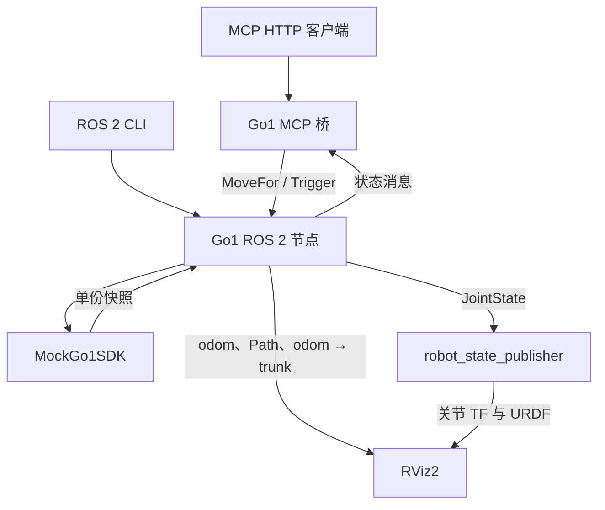

# 架构与控制协议

## ROS 接口与数据来源

| 接口 | ROS 2 类型 | 行为 |
| --- | --- | --- |
| `/go1/cmd_vel` | `geometry_msgs/msg/Twist` | 机体坐标速度，x 向前、y 向左、z 偏航逆时针。 |
| `/go1/cmd_vel_stamped` | `geometry_msgs/msg/TwistStamped` | 速度与时间戳，frame 空或 `trunk`；过期或未来时间戳被拒绝。 |
| `/go1/stop` | `std_srvs/srv/Trigger` | 同一回调归零速度，运行中的 Action 进入 aborted。 |
| `/go1/status` | `std_srvs/srv/Trigger` | 返回当前状态与最近 Action 的状态、进度、时长和结果说明。 |
| `/go1/move_for` | `go1_interfaces/action/MoveFor` | 有界定时速度，支持反馈、取消、完成、冲突拒绝与外部停止。 |
| `/joint_states` | `sensor_msgs/msg/JointState` | 12 个活动关节，角速度用差分，effort 为空。 |
| `/odom` | `nav_msgs/msg/Odometry` | `odom` 中的位姿与 `trunk` 坐标系中的速度。 |
| `/imu` | `sensor_msgs/msg/Imu` | 从模拟偏航生成姿态与角速度。线加速度 unavailable，covariance 首元素为 −1。 |
| `/battery_state` | `sensor_msgs/msg/BatteryState` | 固定 85% 的演示电量，无法提供的数值为 NaN，location 为 simulated。 |
| `/go1/state`、`/go1/command_events` | `std_msgs/msg/String` | 带模拟标识的 JSON 状态和已接收速度、Action、停止、取消事件。 |
| `/go1/path` | `nav_msgs/msg/Path` | 每移动 3 cm 取样，最多保留 600 点，以 5 Hz 发布。 |
| `/tf`、`/tf_static` | `tf2_msgs/msg/TFMessage` | 模拟节点发布唯一的 `odom → trunk`，关节动静态边由 robot_state_publisher 发布。 |

## 状态机与时间

- 系统以锁保护整个运动状态。SDK 用单调时钟在接收新命令、查询状态和发布定时器时推进积分。世界位移由机体速度按偏航旋转得到；对于一段同时平移、转向的恒定命令，代码对这组微分方程求闭式积分，并在到期时刻拆段。
- Topic 线速度向量限制为 0.6 m/s，偏航限制为 1.5 rad/s。具有 DDS 源时间戳时，Watchdog 从发送时间计时。缺省源时间戳时从接收时间计时。Stamped 入口校验 ROS 时钟，并将剩余有效期交给单调时钟。无效数值、过期命令和乱序命令直接拒绝。
- Topic 的默认租期为 0.5 s。Action 接管 Topic，租期由显式时长确定，最长 30 s。Action 占用时拒绝其它非零速度与第二个 Action。零速度、Stop Service 和取消都可中止运动。停止保持期为 0.15 s，拒绝保持期前积压的速度指令。
- Action 接收回调预留任务编号，实际运行从接受句柄开始。执行协程等待 ROS Future；发布定时器推动时间、状态和反馈，并在任务进入终态时完成 Future。单线程 Executor 仍可响应滚动 Topic、Service 和 Cancel。
- 模拟器没有持续执行运动的后台线程。默认 Launch 在模拟进程或 MCP 桥进程退出后关闭整组进程。独立 MCP 进程崩溃时，已经被 ROS 接受的任务受 MoveFor 最大租期约束。
- 默认姿势为每条腿 `(0, 0.75, -1.50)` rad，按 URDF 长度和足端半径计算机身高度。四足动画使用两组相差 π 的对角腿相位，速度影响频率及摆幅，指数平滑让起止姿态连续。基于 URDF 的位置限位每帧执行。

## MCP 边界

`loco.move` 将 Go1 卡片的 `vyaw` 从 °/s 转为 rad/s，把 `duration`（0 或省略使用 0.5 s）作为 Action goal 发送。HTTP 返回 `accepted` 意味着 ROS 已接收，完成状态读取 `loco_state`。停止调用 Trigger 并等候响应。网络请求线程与 ROS Executor 彼此独立。

桥进程读取标准 ROS 消息并只缓存近期样本，关节骨架通过 URDF 名称映射和 JointState 重排，同时按时间戳匹配 IMU 四元数。在 `/go1_mock/state/joints` 输出 Dashboard 的 `sensor/skeleton` JSON。状态、IMU、电池也有独立的 JSON 流。请求与输出都不访问真机。

## 换成真机的接口边界

1. 在模拟节点与控制仲裁之间引入硬件后端，依据原 Go1 `SdkProxy` 适配启动、读取、停机和生命周期。保留 Action、Topic、Service 与 MCP 合同，并验证命令刷新频率及过期策略。
2. 把 HighState 的时间戳、关节序号、wxyz 四元数、电池和实测位姿转换成 ROS 消息。明确全局/机体坐标变换，用实测里程计和 IMU 替代模拟积分。断链或无新状态时撤销运动权限。
3. 另行配置具备授权的真机网络与隔离 DDS，使用厂家限速和急停，先离线回放和架空验证，再进行现场测试。当前交付没有执行真机操作。
